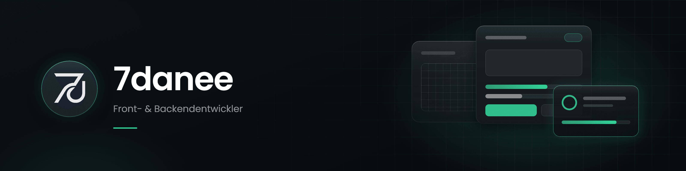

  

  UI / NUI für GTA-V-Roleplay · Webentwicklung &amp; Design unter <b>havelmade</b>

---

### Hey, ich bin Julian.

Ich konzipiere, gestalte und baue Interfaces – vor allem NUI für GTA-V-Roleplay-Server.
Mein Fokus liegt auf zwei Dingen: Performance und eine hochwertige visuelle Darstellung.
Daneben arbeite ich freiberuflich als Webentwickler und Designer unter der Marke **havelmade** (Havelland, Brandenburg).

### Arbeitsweise

**Design-Manual → Richtlinien → Umsetzung.**
Ich arbeite KI-gestützt, aber ein Prompt allein ergibt kein gutes Design. Dafür braucht es ein Design-Manual, klare Richtlinien und jemanden, der das Ganze durchdenkt. Mein Schwerpunkt ist die UI; Backend-Aufgaben unterstütze ich bei Bedarf, ebenfalls KI-gestützt.

### Erfahrung

- Langjährige Entwicklung von Inhalten für GTA V – Modding auf **alt:V**, **RageMP** und **FiveM** (mit FiveM seit Jahren)
- Mitarbeit als Entwickler bei **gCity** unter der Leitung von Isaac
- Abgeschlossene Ausbildung zum Mediengestalter, Schwerpunkt Digital
- Ein Jahr Ausbildung als Fachinformatiker für Anwendungsentwicklung
- Grundlagen selbst beigebracht, in der Ausbildung vertieft

### Highlight

  

  <b><a href="https://github.com/7danee/gta-portfolio">gta-portfolio</a></b> · UI-Showcase meiner NUI-Arbeit für GTA-V-Roleplay

### Berührungspunkte

  
  
  
  
  
  
  
  

### Kontakt

Discord: `7danee`
